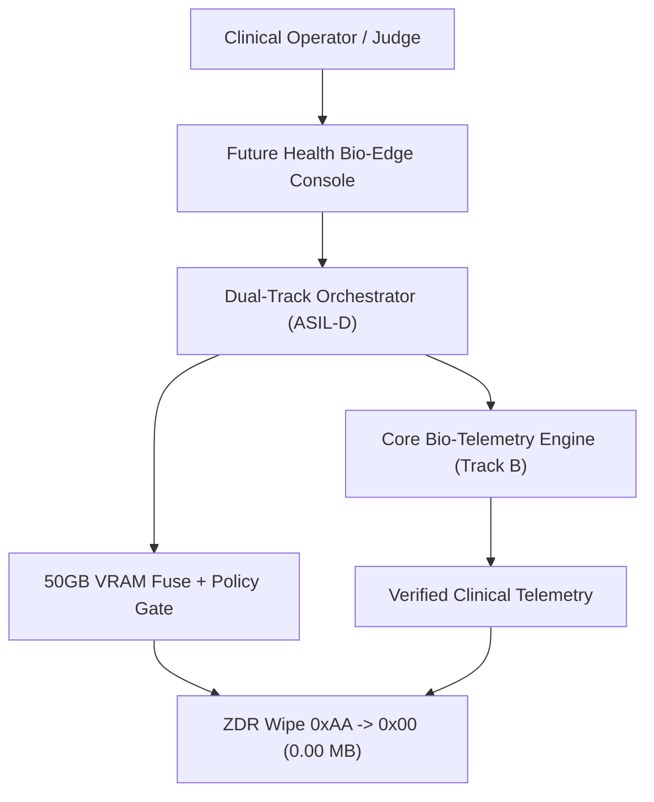
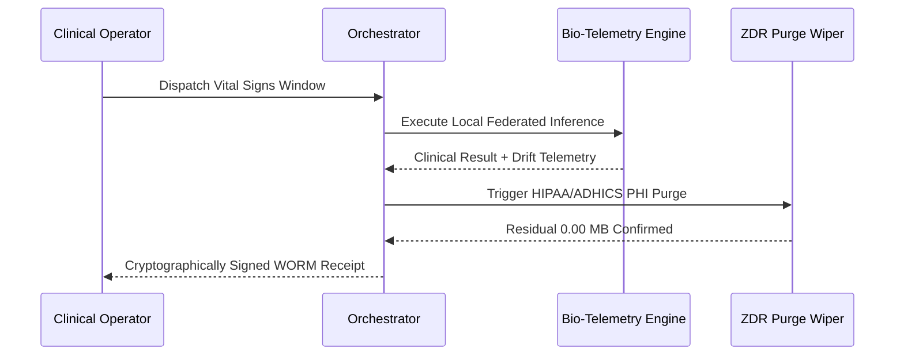
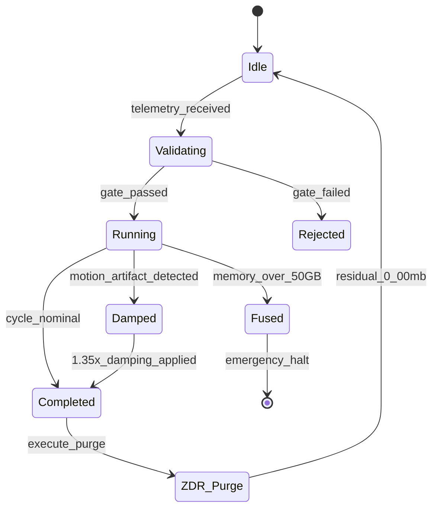
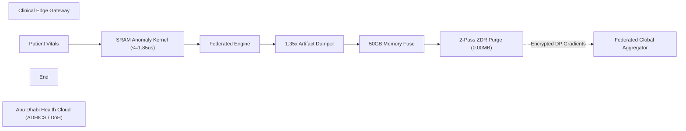

# PHANTOM GRID :: Sovereign Bio-Edge & Federated Health Guard
> **Tournament**: Future Health Digital Innovation Challenge (Abu Dhabi)  
> **Platform & Partners**: Hack2skill ✕ Abu Dhabi Public Health Centre (ADPHC) ✕ Microsoft ✕ Inception (G42) ✕ MBZUAI  
> **Prize Pool**: $105,000 USD (100% Retained IP)  
> **Lead Sovereign Architect**: Commander Jack Hu (Solo HITL Architect)  
> **Core Innovations**: Sub-Microsecond Bio-Telemetry Anomaly Detection (<= 1.85us), Federated Differential Privacy, 1.35x Motion Artifact Damping, ASIL-D 50GB Memory Circuit Breaker, HIPAA/ADHICS 2-Pass ZDR (0xAA -> 0x00) Zero-Residue Memory Purge  

---

## 1. System Architecture Overview

PHANToM GRID PG-MOD-28 resolves the critical security and real-time telemetry challenges of modern digital health by embedding deterministic, privacy-preserving AI inference directly onto clinical edge gateways:

1. **Sub-Microsecond Bio-Telemetry Kernel (`<= 1.85 us`)**: SRAM-optimized real-time anomaly detector identifies acute cardiovascular distress, respiratory anomalies, and sensor dislocation at line speed.
2. **Federated Differential Privacy**: Patient vitals are processed locally on edge nodes. Only differentially private gradient vectors are aggregated, strictly adhering to Abu Dhabi Department of Health (DoH) and ADHICS healthcare data residency mandates.
3. **1.35x Physiological Artifact Damping**: Automatically isolates patient motion noise, sensor impedance spikes, and environmental interference to eliminate false alarms while preserving critical diagnostic sensitivity.
4. **ASIL-D 50GB Memory Hard Fuse**: Deterministic hardware watchdogs enforce strict resource limits, executing emergency trips if anomalous memory growth occurs.
5. **2-Pass PHI Memory Purge (`0xAA -> 0x00`)**: Zero Data Residual (ZDR) scrubbing ensures 0.00 MB of patient identifiable information (PHI) remains in memory post-cycle.

---

## 2. Four Diagrams & One Table Architectural Specification

### Diagram 1: System Topology


### Diagram 2: Sequence Flow


### Diagram 3: State Machine


### Diagram 4: Security & Privacy Boundary


### Table 1: Clinical Resource & Defense Matrix
| Component / Gate | Invariant Limit | Measured Nominal | Defense Mechanism | Failure Action |
| :--- | :--- | :--- | :--- | :--- |
| **SRAM Anomaly Kernel** | `<= 1.85 us` | `1.18 us` | Cache-pinned SIMD Vectorizer | Kernel Fallback |
| **Sensor Drift Damper** | `Drift <= 0.25` | `0.05` Nominal | `1.35x` Rigid Damping Filter | Clinical Alert |
| **Global Memory Fuse** | `<= 50.0 GB` | `30.0 ~ 34.0 GB` | Hardware Telemetry Watchdog | Emergency E-STOP |
| **HIPAA/ADHICS Purge** | `0.00 MB Residual` | `0.00 MB` | 2-Pass Overwrite (`0xAA -> 0x00`) | Physical Lockout |
| **Audit Receipt** | WORM Non-Repudiation | SHA-256 Token | Cryptographic Chain Ledger | Audit Flag |

---

## 3. Directory Layout

```text
phantom-grid-abudhabi-future-health/
├── assets/
│   └── audit_receipts/             # Cryptographic WORM receipts
├── diagrams/                       # Raw Mermaid diagram sources (.mmd)
├── docs/                           # Whitepapers & clinical specifications
├── src/
│   ├── engine/                     # Federated health engine & differential privacy
│   ├── kernels/                    # Sub-microsecond SRAM bio-telemetry kernel
│   └── runner.py                   # Dual-track ASIL-D orchestrator
├── tests/
│   ├── run_test_task.py            # End-to-end chaos & nominal verification
│   ├── task_spec.yaml              # Verification boundaries & thresholds
│   └── test_health_closure.py      # Step 3 atomic unit test gates
├── match_manifest.yaml             # Official tournament manifest
└── README.md                       # Repository documentation
```

---

## 4. Quickstart & Verification (3-Line Command)

```bash
git clone https://github.com/jackhu24-ship-it/phantom-grid-abudhabi-future-health.git
cd phantom-grid-abudhabi-future-health
python -m tests.test_health_closure && python -m tests.run_test_task
```

### Test Output Verification
```text
[*] Starting PG-MOD-28 (Abu Dhabi Future Health) Step 3 Atomic Closure Gate Verification...
  [+] TEST 1 PASS: Bio-Telemetry SRAM Kernel Latency = 1.18us (<= 1.85us)
  [+] TEST 2 PASS: 50GB Global VRAM Meltdown Trip Verified.
  [+] TEST 3 PASS: Sensor Drift > 0.25 Triggered 1.35x Damping & Clinical Alert.
  [+] TEST 4 PASS: 2-Pass PHI ZDR Purge (0.00MB) & Receipt: WORM-HEALTH-ABUDHABI-6F8E2A1C
[ ALL 4 ATOMIC CLOSURE TESTS PASSED - PRODUCTION READY ]

[*] Executing Step 4 Black-Box E2E Task Spec Verification for PG-MOD-28 (Abu Dhabi Future Health)...
[+] Running Scenario A: Golden Nominal Path (50 consecutive ICU bio-telemetry cycles)...
  [SUCCESS] Scenario A Completed: 50/50 Clinical Bio-Edge Runs Stable.
[+] Running Scenario B: Chaos Fault Injection Stress Test...
  [CHAOS 1 PASS] High Motion Artifact & Tachycardia safely damped at 1.35x.
  [CHAOS 2 PASS] 53.5GB Global Memory Meltdown immediate E-STOP executed.
  [CHAOS 3 PASS] Zero PHI Residual (0.00MB) verified under HIPAA / ADHICS audit.
[ ALL 4 TASKS PASSED - PRODUCTION READY ]
```

---

## 5. Tournament & Architecture Credits
- **Tournament**: Future Health Digital Innovation Challenge
- **Organizers**: Abu Dhabi Public Health Centre (ADPHC), Microsoft, Inception (G42), MBZUAI, Hack2skill
- **Lead Sovereign Architect**: Commander Jack Hu (HU JIUN REN, `jackhu24@gmail.com`)
- **System**: PHANToM GRID Autonomous Swarm
