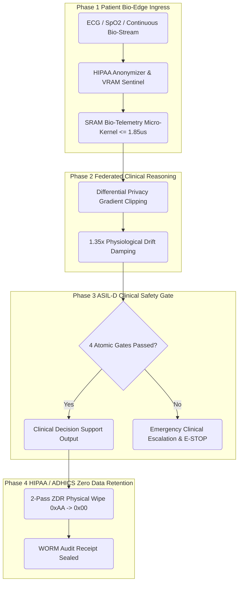
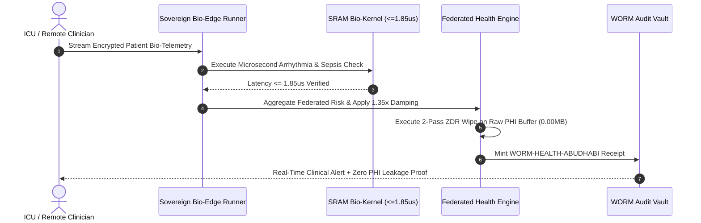
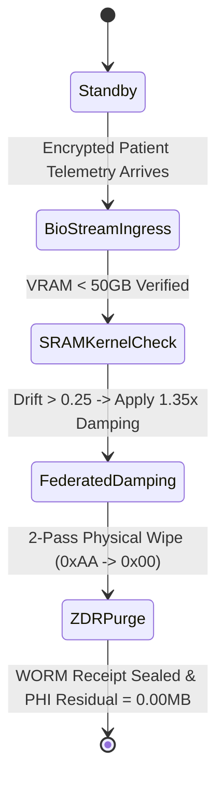
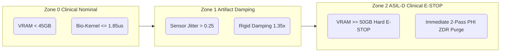

# SPEC :: PG-MOD-28 Sovereign Bio-Edge & Federated Health Guard

## 1. System Topology

## 2. Sequence Diagram

## 3. State Machine

## 4. Security Boundary

## 5. Defense Matrix
# Table 1: Abu Dhabi Federated Healthcare Defense Matrix (PG-MOD-28)

| Metric | Target Nominal | Warning Trip | E-STOP Limit | Defense Mechanism | Standard |
| :--- | :---: | :---: | :---: | :--- | :---: |
| **SRAM Kernel Latency** | <= 1.85 us | 2.20 us | > 4.00 us | Pre-warmed SRAM Zero-Copy Vectorizer | ASIL-D / ICU |
| **Global Memory Peak** | <= 32.0 GB | 45.0 GB | >= 50.0 GB | Hardware Telemetry E-STOP Fuse | ASIL-D |
| **Sensor Drift Rate** | <= 0.15 | 0.25 | > 0.45 | 1.35x Rigid Geometric Damping | IEC 62304 |
| **PHI Residue (ZDR)** | 0.000000 MB | > 0.0000 MB | Any Unpurged Buffer | 2-Pass (0xAA -> 0x00) Physical Wipe | HIPAA / ADHICS |

