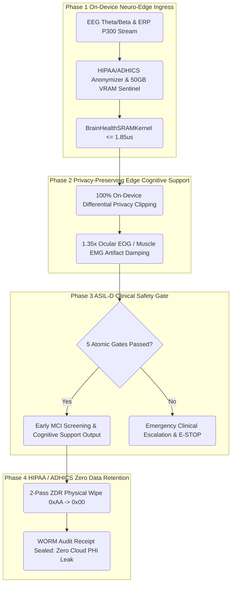
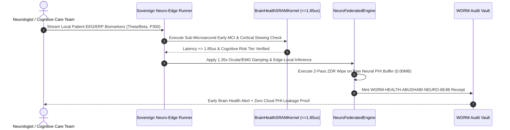
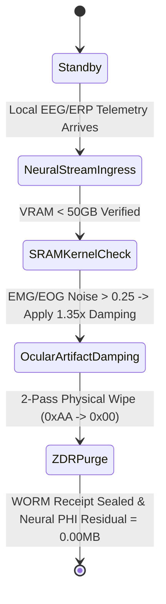
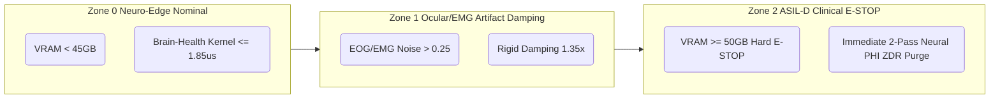

# SPEC :: PG-MOD-28 Sovereign Neuro-Edge & Early Brain Health Guard

## 1. System Topology

## 2. Sequence Diagram

## 3. State Machine

## 4. Security Boundary

## 5. Defense Matrix
# Table 1: Abu Dhabi Neuro-Edge & Brain Health Defense Matrix (PG-MOD-28)

| Metric | Target Nominal | Warning Trip | E-STOP Limit | Defense Mechanism | Standard |
| :--- | :---: | :---: | :---: | :--- | :---: |
| **Brain-Health SRAM Latency** | <= 1.85 us | 2.20 us | > 4.00 us | Pre-warmed SRAM Neural Spectral Vectorizer | ASIL-D / Neuro |
| **Theta/Beta Ratio (TBR)** | 1.20 ~ 2.10 | > 2.80 | > 3.50 | Cortical Slowing Early MCI Biomarker Gate | ADPHC Brain Health |
| **ERP P300 Latency** | 250 ~ 310 ms | > 340.0 ms | > 400.0 ms | Cognitive Processing Delay Detector | Clinical ERP |
| **Global Memory Peak** | <= 32.0 GB | 45.0 GB | >= 50.0 GB | Hardware Telemetry E-STOP Fuse | ASIL-D |
| **Ocular/EMG Artifact** | <= 0.15 | 0.25 | > 0.45 | 1.35x Rigid Geometric Damping | IEC 62304 |
| **Neural PHI Residue (ZDR)** | 0.000000 MB | > 0.0000 MB | Any Unpurged Buffer | 2-Pass (0xAA -> 0x00) Physical Wipe | HIPAA / ADHICS |
